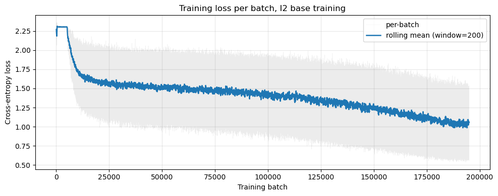
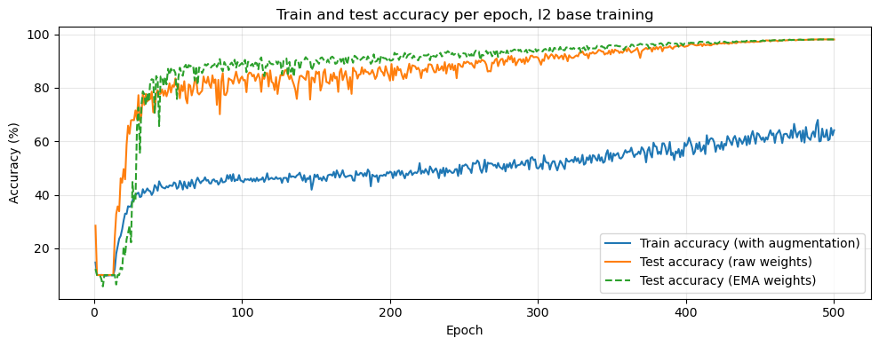
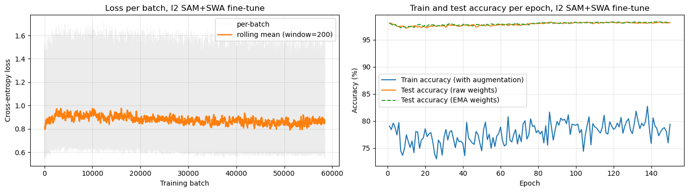

# CIFAR-10 classification with a Selective-Kernel-style CNN ensemble

Author: Artem Zeleniuk

[](https://colab.research.google.com/github/artem-zeleniuk/cifar10-sknet/blob/main/notebooks/cifar10_sknet_ensemble.ipynb)

The ensemble of four networks reaches 98.42% test accuracy. Averaging over horizontal flips raises three of the four single networks by 0.05 to 0.10 points but lowers the ensemble to 98.37%. The best single network reaches 98.36% with flip averaging.

This repository holds the training code (a small library and a command-line script), a Jupyter notebook that defines, trains and evaluates the same convolutional networks for CIFAR-10 (60,000 colour images of 32x32 pixels in 10 classes, 50,000 for training and 10,000 for testing, Krizhevsky, 2009), and a script that checks the published results. The networks are built from one kind of attention block: a few convolutions run side by side on the same input, and a weight per convolution, computed from that input, decides how much each one contributes. `evaluate.py` and the notebook load the trained weights from Hugging Face, so the reported results can be checked without retraining.

## Quick start

1. `python evaluate.py` downloads the four ensemble checkpoints, checks their SHA-256 and prints the test accuracy of each model and of the ensemble (see "How to reproduce").
2. [`notebooks/cifar10_sknet_ensemble.ipynb`](notebooks/cifar10_sknet_ensemble.ipynb) holds the model, the training loop and the results of the best single network and of the ensemble, with the outputs saved from a Colab run.
3. `train.py` trains one configuration from scratch. [`experiments.md`](experiments.md) gives the command of every published run (see "Training").

## Question

How accurate can a CIFAR-10 classifier get when it is built from simplified Selective Kernel blocks (described below), and how much does each of these choices improve its accuracy: more channels per stage, the arrangement of the blocks (27 blocks in a row, or 14 blocks with plain convolutions between them), MixUp, a fine-tune with sharpness-aware minimisation (SAM) and an ensemble of four networks?

## Method in short

### Block

Each block (called the intermediate block in the code and the notebook) computes

```math
x' = \sum_{l=1}^{L} a_l \, C_l(x)
```

- `x` is the input feature map (c channels, height H, width W) and `x'` is the output feature map of the same height and width.
- `C_l` is branch number l: a convolution (3x3, 1x1 or 3x3 with dilation 2) followed by batch normalisation and ReLU. All branches see the same `x`.
- `L` is the number of branches (2 or 3 here).
- `a_l` is the attention weight of branch l, one number per branch, computed anew for every image. The weights are not normalised (no softmax), so they need not sum to 1.

The attention weights come from

```math
a = \mathrm{FC}(\mathrm{GAP}(x))
```

- `GAP(x)` is global average pooling: the mean of each channel of `x` over all pixels, a vector of length c.
- `FC` is one fully connected layer with c inputs and L outputs, so `a` is a vector of length L.

This is a simplified form of Selective Kernel Networks (Li et al., 2019): the weights are computed from the input of the block rather than from the sum of the branch outputs, there is one weight per branch instead of one per channel, and there is no softmax over the branches and no bottleneck layer.

### Network

A first 3x3 convolution (the stem), then three stages that work at 32x32, 16x16 and 8x8 pixels. Between stages a stride-2 convolution halves the image size and doubles the number of channels (for example 160, 320 and 640). Every block has a skip connection (its input is added to its output, as in ResNet, He et al., 2016). Some configurations also place an "intra-transition" between consecutive blocks of a stage: one plain 3x3 convolution with batch normalisation and ReLU, without branches, attention weights or skip connection. The network ends with global average pooling and one fully connected layer with 10 outputs. Setting `basic_mode=True` removes the skip connections, the intra-transitions and DropPath, which leaves a plain sequence of attention blocks with 3x3 and 1x1 branches. A unit test in the notebook checks this.

The final models use two architectures:

| Configurations | Channels per stage | Blocks per stage | Intra-transitions | Branches | Parameters |
|---|---|---|---|---|---|
| 1.1 | 160, 320, 640 | 9, 9, 9 (27 blocks) | no | 3x3 and 1x1 | 51.02M |
| I1, I2 | 192, 384, 768 | 5, 5, 4 (14 blocks) | yes | 3x3 and 1x1 | 59.12M |

I1 also uses DropPath, a per-image variant of stochastic depth (Huang et al., 2016, who drop a block for a whole batch): during training, for each image, the output of a block is dropped at random, so only its skip connection passes the input on. The probability is 0 for the first block and grows linearly with depth to 0.10 for the last (14th) block. At test time no block is dropped.

### Names

The configuration names come from the experiments. 1.1 and 1.2 stack nine blocks per stage, 2.1 and 2.2 use five, five and four blocks with intra-transitions, and the second digit is the set of branches (1: 3x3 and 1x1 with 160, 320 and 640 channels, 2: 1x1, 3x3 and dilated 3x3 with 120, 240 and 480 channels). No run uses 1.2. I1 and I2 are 2.1 with 192, 384 and 768 channels instead of 160, 320 and 640. All base runs use CutMix. I2 is also trained with MixUp, I1 with DropPath. In the model names, `ft_` marks a SAM and SWA fine-tune, `historical` a base model without fine-tune, and `g0` is the run name of the 1.1 base with 25 warmup epochs and MixUp. The names are kept because the checkpoints, the logs and the code use them.

### Training of the base models (500 epochs)

SGD with Nesterov momentum 0.9 (Sutskever et al., 2013), learning rate 0.1, reached by a linear warmup (from 0.001 in equal steps over the first 5 epochs, 25 for the base of `ft_g0`), then cosine decay to 0 (Loshchilov and Hutter, 2017), weight decay 5e-4, batch size 128, cross-entropy with label smoothing 0.1 (Szegedy et al., 2016), which sets the target to 0.91 for the true class and 0.01 for each of the other nine instead of 1 and 0. Per-image augmentation: random crop with 4-pixel reflect padding, horizontal flip, TrivialAugment (Müller and Hutter, 2021, one random photometric or geometric change per image) and Cutout (DeVries and Taylor, 2017, a random 16x16 square is blanked). Per-batch augmentation: CutMix (Yun et al., 2019, a rectangle of random size from another image of the batch is pasted in, and the target becomes a mix of the two labels in proportion to their areas, for example 70% of one class and 30% of the other) with probability 0.5, and for I2 and the base of `ft_g0` also MixUp (Zhang et al., 2018, two images and their labels are averaged with a random weight) with probability 0.5, so that every batch of these runs gets one of the two. An exponential moving average (EMA) of the weights is kept next to the raw weights (decay 0.999, roughly the last 1,000 batches). After every epoch both are evaluated on the test set, and a copy of the better one is saved if it beats the best result so far. Training itself always continues with the raw weights. Base training uses bfloat16 mixed precision. Gradients are clipped element-wise at 10 and then to a total norm of 5.

### Fine-tune

Three of the base models (I2 and both 1.1 bases) were then trained for 150 more epochs, all three with the same settings. Each fine-tune starts from the saved weights of its base run, the best epoch, raw or EMA, whichever scored higher (raw for `ft_I2` and `ft_g0`, EMA for `ft_1_1`). The optimiser is sharpness-aware minimisation (SAM, Foret et al., 2021, radius 0.05): each update first moves the weights a small step in the direction in which the loss grows fastest and uses the gradient taken there, which steers training towards flat regions of the loss surface. The learning rate is 0.005 with 5 warmup epochs and cosine decay. After epoch 75 it is held at 0.001, and stochastic weight averaging (SWA, Izmailov et al., 2018) adds the weights after every epoch to a running mean. At the end the BatchNorm statistics of this mean are recomputed on the training images and the mean is evaluated as a separate model. It scored lower than the best epoch in every fine-tune, so it is stored but not used (see "Findings"). The CutMix and MixUp probabilities are lowered to 0.25 each. The SAM fine-tunes run in 32-bit precision, because the training code switches mixed precision off when SAM is on. SAM and DropPath do not combine in this code, so I1 was fine-tuned with SWA only. That fine-tune scored 0.02 points below its base, so I1 is used without fine-tune.

Each run has its own settings. [`experiments.md`](experiments.md) gives the `train.py` command of every run, reconstructed from the arguments that `train.py` stored with the run, and the header of each log in [`logs/`](logs) prints the configuration of the run and, when set, its warmup, MixUp, SAM, SWA, DropPath and starting-checkpoint options. The table under "Training" lists the settings of the runs behind the ensemble.

### Ensemble

Four models, two with configuration 1.1 (`ft_g0`, `ft_1_1`) and two with the wider 14-block layout (`ft_I2`, `I1_historical`). The ensemble averages the softmax outputs of the four models. With flip averaging each model also sees the mirrored test image and its two softmax outputs are averaged first.

## Results

All numbers are accuracy on the 10,000 CIFAR-10 test images, as printed by Section 13 of the notebook.

| Model | Network | Plain | With flip averaging |
|---|---|---|---|
| `ft_I2` | I2 (base trained with CutMix and MixUp), fine-tuned (best single network) | 98.31% | 98.36% |
| `ft_g0` | 1.1 (base trained with CutMix, MixUp and 25 warmup epochs), fine-tuned | 98.26% | 98.25% |
| `ft_1_1` | 1.1 (base trained with CutMix), fine-tuned | 97.96% | 98.05% |
| `I1_historical` | I1 (base trained with CutMix and DropPath), without fine-tune | 97.99% | 98.09% |
| **Ensemble of the four** | mean of their softmax outputs | **98.42%** | 98.37% |

Section 11 of the notebook evaluates `ft_I2` with flip averaging done by adding logits instead of averaging softmax outputs, which gives 98.35%.

What each change added (one run each, best epoch on the test set):

| Run | Change from the row above | Epochs | Best test accuracy | Source |
|---|---|---|---|---|
| 2.1 | starting point: 14 blocks with intra-transitions, 160/320/640 channels, CutMix | 500 | 97.78% | `logs/compare_2_1_500ep.log` |
| I2 architecture | 192/384/768 channels | 500 | 97.80% | `logs/compare_wider_no_mixup_500ep.log` |
| I2 base | MixUp added | 500 | 98.10% | notebook, Section 10 |
| `ft_I2` | 150 more epochs with SAM | 500 + 150 | 98.31% | notebook, Section 11 |
| Ensemble | four networks averaged | 500 or 500 + 150 | 98.42% | notebook, Section 13 |

### Findings

- MixUp gave the largest gain. Adding MixUp to the I2 base raised its accuracy from 97.80% to 98.10%.
- More channels alone did not help. Widening 2.1 from 160/320/640 to 192/384/768 channels changed 97.78% to 97.80%, which is within the noise.
- The two block layouts were close. Trained the same way, 27 blocks in a row (1.1, `logs/base_1_1_warmup5.log`) reached 97.92% and 14 blocks with intra-transitions (2.1, 41.06M parameters against 51.02M) reached 97.78%. With one run each and a 10M difference in size, a gap of 0.14 points is not conclusive.
- The fine-tune added about 0.2 points (98.10% to 98.31%). No fine-tune without SAM was run, so this gain is not split between SAM and the 150 extra epochs.
- The ensemble added 0.11 points over the best single network (98.31% to 98.42%).
- Flip averaging helped three of the four single networks (by 0.05 to 0.10 points) but not the ensemble, which went from 98.42% to 98.37%.
- The SWA average was worse than the best epoch. In all four fine-tunes the final SWA average scored 97.02% to 97.39% (`logs/finetune_*.log`), 0.8 to 1.1 points below the best epoch, so the kept fine-tuned weights are those of the best epoch (raw or EMA). The reason was not investigated.

Training curves of the best single network: its base run (I2, 500 epochs, per-batch loss and per-epoch accuracy) and its fine-tune, the final run that produced `ft_I2`:





The train accuracy in these plots is measured on augmented and mixed batches, which is why it stays far below the test accuracy.

### Limitations

- The test set was used for model selection. There is no separate validation split. For every run the kept checkpoint is the epoch with the highest test accuracy, and the ensemble members were also chosen by test accuracy. The numbers are therefore optimistic estimates of accuracy on new data.
- One run per configuration. Each configuration was trained once (the stored settings show seed 42), so there is no spread over seeds.
- Differences of a few hundredths of a point should be read as noise. For example, the same `ft_I2` weights score 98.29% when evaluated during training (32-bit precision, on the training GPU) and 98.31% in the notebook (bfloat16 on a T4), and `ft_1_1` scores 98.00% and 97.96% in the same two settings (`logs/finetune_1_1.log`, notebook Section 13).
- No valid comparison of the branch sets. The two branch sets were compared only in two early 300-epoch runs whose code had a bug (the BatchNorm weights of all branches stayed zero, so the blocks did not contribute). These runs are not included.

## How to reproduce

### Evaluate the published models

```
pip install -r requirements.txt
python evaluate.py
```

`evaluate.py` downloads the four ensemble checkpoints (about 1.5 GB) from Hugging Face into `weights/`, checks each file against its SHA-256 in [`SHA256SUMS`](SHA256SUMS) before loading it, downloads the CIFAR-10 test set into `./data` and prints the test accuracy of each of the four models and of the ensemble, without and with flip averaging, next to the values saved in the notebook. It repeats the evaluation of Section 13 of the notebook. A GPU is recommended, because on the CPU the evaluation is slow. On an RTX 4090 it reproduced the values saved in the notebook (from a Tesla T4) to within two of the 10,000 test images. Such small differences probably come from the rounding of 16-bit (bfloat16) arithmetic, which differs between GPU types.

### Run the notebook

GitHub shows the notebook with the outputs saved from a Colab run, so its numbers and plots can be read without running it.

1. Open `notebooks/cifar10_sknet_ensemble.ipynb` in Google Colab with a GPU runtime (badge above), or locally after `pip install -r requirements.txt`. The saved text outputs were produced on Colab with a Tesla T4 GPU. The three training-curve plots were drawn again later from the same statistics files, only to change their titles.
2. Run all cells. With the default flags (`LOAD_PRETRAINED = True`, `LOAD_PRETRAINED_ENSEMBLE = True`) the notebook downloads CIFAR-10 (about 170 MB) into `./data` and about 1.8 GB of checkpoints and statistics from [huggingface.co/Artem3000-dev/cifar-10-sknet](https://huggingface.co/Artem3000-dev/cifar-10-sknet) into the working directory, then evaluates them. The checkpoints are pickled Python objects loaded with `weights_only=False`, so load them only from this source. [`SHA256SUMS`](SHA256SUMS) lists their SHA-256 checksums. To check the downloaded files, run `sha256sum -c --ignore-missing <path to SHA256SUMS>` in the folder that holds them. For a local run of the notebook this is `sha256sum -c --ignore-missing ../SHA256SUMS` in `notebooks/`.
3. To train instead of loading, set `LOAD_PRETRAINED = False`. That branch trains the I2 base for 500 epochs with the settings of the published run (5 warmup epochs, MixUp) and skips the fine-tune. The published I2 runs took 277.5 min (base) and 245.3 min (fine-tune), each on one cloud GPU. To repeat them with the stored settings, run the notebook up to Section 8 and then:

```python
base = train_one_config(RUN_CONFIGS['I2'], num_epochs=500, warmup_epochs=5, mixup_prob=0.5)
torch.save({'cfg': base['cfg'], 'state_dict': base['best_state'],
            'best_acc': base['best_acc'], 'best_is_ema': base['best_is_ema']}, 'I2_base.pt')

ft = train_one_config(RUN_CONFIGS['I2'], num_epochs=150, lr=0.005, warmup_epochs=5,
                      cutmix_prob=0.25, mixup_prob=0.25,
                      use_sam=True, sam_rho=0.05,
                      use_swa=True, swa_start_epoch=75, swa_lr=0.001,
                      init_from='I2_base.pt')
```

The training code has not been re-run end to end since the published runs, so a retrained model may differ slightly from the published checkpoints. cuDNN benchmark mode is on (PyTorch then picks the fastest convolution algorithm at run time), so runs are not bit-for-bit repeatable even with the fixed seed.

## Training

`train.py` trains one configuration on one GPU, with the model and training loop from [`sknet/lib.py`](sknet/lib.py), which defines six configurations: 1.1, I1 and I2 of the ensemble, 2.1 and 2.2 of the comparison runs in `logs/`, and 1.2, which no run in this repository uses. The runs behind the four ensemble members used these settings:

| Run | Configuration | Epochs | Starts from | Learning rate | Warmup epochs | CutMix, MixUp probability | Other |
|---|---|---|---|---|---|---|---|
| I2 base | I2 | 500 | random weights | 0.1 | 5 | 0.5, 0.5 | none |
| `ft_I2` | I2 | 150 | I2 base | 0.005, after epoch 75 0.001 | 5 | 0.25, 0.25 | SAM, SWA |
| base of `ft_g0` | 1.1 | 500 | random weights | 0.1 | 25 | 0.5, 0.5 | none |
| `ft_g0` | 1.1 | 150 | base of `ft_g0` | 0.005, after epoch 75 0.001 | 5 | 0.25, 0.25 | SAM, SWA |
| base of `ft_1_1` | 1.1 | 500 | random weights | 0.1 | 5 | 0.5, 0 | none |
| `ft_1_1` | 1.1 | 150 | base of `ft_1_1` | 0.005, after epoch 75 0.001 | 5 | 0.25, 0.25 | SAM, SWA |
| `I1_historical` | I1 | 500 | random weights | 0.1 | 5 | 0.5, 0 | DropPath up to 0.10 |

All runs use SGD with Nesterov momentum 0.9, weight decay 5e-4, batch size 128, label smoothing 0.1, an EMA with decay 0.999 and the per-image augmentation described under "Method in short". SAM uses radius 0.05.

The two runs of the best single network as commands:

```
pip install -r requirements.txt
python train.py --run I2 --epochs 500 --warmup-epochs 5 --mixup-prob 0.5 --out-dir runs/I2_base
python train.py --run I2 --epochs 150 --lr 0.005 --warmup-epochs 5 --cutmix-prob 0.25 --mixup-prob 0.25 --use-sam --sam-rho 0.05 --use-swa --swa-start 75 --swa-lr 0.001 --num-workers 6 --init-from runs/I2_base/ckpt_run_I2.pt --out-dir runs/ft_I2
```

CIFAR-10 is downloaded into `./data` on the first run. [`experiments.md`](experiments.md) gives the command and the log of every run in the table above and of the runs in "What each change added". `python tests/test_smoke.py` (or `python -m pytest tests`) builds every configuration and runs one forward and backward pass on the CPU in about 10 seconds. The notebook carries the same model and training code as `sknet/lib.py`.

## Repository contents

| Path | Content |
|---|---|
| `evaluate.py` | downloads and checks the four ensemble checkpoints and prints their test accuracy and that of the ensemble |
| `notebooks/cifar10_sknet_ensemble.ipynb` | the model, the training and the evaluation in one document, to read on GitHub or run in Colab without installing anything: the code of `sknet/lib.py` written out cell by cell with explanations, the evaluation of the best single network and of the ensemble (the one `evaluate.py` repeats), and the saved outputs of a Colab run with the numbers and plots of the best single network and of the ensemble |
| `sknet/lib.py` | model, data pipeline and training loop used by `train.py` |
| `sknet_lib.py` | a short alias for `sknet/lib.py`. The checkpoints were saved when the library was one file named `sknet_lib.py`, so loading them needs a module with that name |
| `train.py` | command-line training of one configuration |
| `tta_eval.py` | evaluation of one checkpoint with several kinds of test-time augmentation |
| `experiments.md` | command and log of every run |
| `tests/test_smoke.py` | smoke test on the CPU |
| `requirements.txt` | Python packages |
| `figures/` | the three plots shown above, taken from the notebook outputs |
| `logs/` | text logs of the training runs behind the published checkpoints and of the comparison runs cited above |
| `SHA256SUMS` | SHA-256 checksums of the logs, the figures and the 9 files on Hugging Face |
| `LICENSE` | MIT licence |

## Not included

- Trained weights and training statistics (9 files, 2.0 GB, up to 473 MB each). GitHub does not accept files over 100 MB, so they are on Hugging Face (link above). `evaluate.py` and the notebook download them.
- The CIFAR-10 data. torchvision downloads it on first use.
- Scripts that only managed the rented cloud machines (setup, shutdown, upload of the weights).
- The earlier versions of the training code, which ran the base runs of I2, I1 and 1.1 with 5 warmup epochs and the comparison runs. They were not kept, so a model retrained with the current code may differ slightly from the published one.
- Earlier development runs that are not used by the notebook or listed in `experiments.md`.

## References

- A. Krizhevsky. Learning Multiple Layers of Features from Tiny Images. Technical report, University of Toronto, 2009.
- X. Li, W. Wang, X. Hu, J. Yang. Selective Kernel Networks. CVPR 2019.
- K. He, X. Zhang, S. Ren, J. Sun. Deep Residual Learning for Image Recognition. CVPR 2016.
- G. Huang, Y. Sun, Z. Liu, D. Sedra, K. Q. Weinberger. Deep Networks with Stochastic Depth. ECCV 2016.
- I. Sutskever, J. Martens, G. Dahl, G. Hinton. On the importance of initialization and momentum in deep learning. ICML 2013.
- I. Loshchilov, F. Hutter. SGDR: Stochastic Gradient Descent with Warm Restarts. ICLR 2017.
- C. Szegedy, V. Vanhoucke, S. Ioffe, J. Shlens, Z. Wojna. Rethinking the Inception Architecture for Computer Vision. CVPR 2016.
- S. G. Müller, F. Hutter. TrivialAugment: Tuning-free Yet State-of-the-Art Data Augmentation. ICCV 2021.
- T. DeVries, G. W. Taylor. Improved Regularization of Convolutional Neural Networks with Cutout. arXiv:1708.04552, 2017.
- S. Yun, D. Han, S. J. Oh, S. Chun, J. Choe, Y. Yoo. CutMix: Regularization Strategy to Train Strong Classifiers with Localizable Features. ICCV 2019.
- H. Zhang, M. Cisse, Y. N. Dauphin, D. Lopez-Paz. mixup: Beyond Empirical Risk Minimization. ICLR 2018.
- P. Foret, A. Kleiner, H. Mobahi, B. Neyshabur. Sharpness-aware Minimization for Efficiently Improving Generalization. ICLR 2021.
- P. Izmailov, D. Podoprikhin, T. Garipov, D. Vetrov, A. G. Wilson. Averaging Weights Leads to Wider Optima and Better Generalization. UAI 2018.
